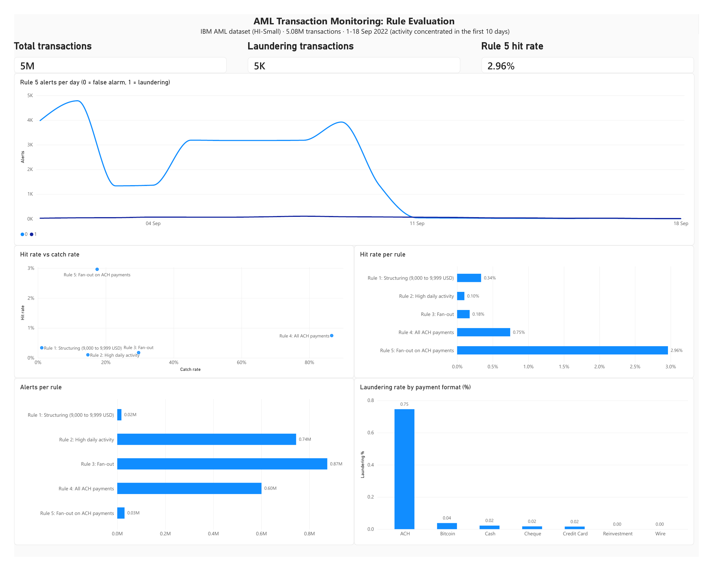

# AML Transaction Monitoring: Rule Evaluation

Evaluating simple anti-money-laundering (AML) monitoring rules on 5 million synthetic bank transactions, measuring how many alerts each rule produces and how many of them are real laundering.

**Tools:** Python (pandas), SQL (SQLite), Power BI

## The question

Banks use rule-based transaction monitoring to flag suspicious activity. Every alert has to be reviewed by an analyst, so a rule is only useful if it finds real laundering **without** burying the team in false alarms.

For each rule, I measured:
- **Hit rate (precision):** what share of flagged transactions are really laundering
- **Catch rate (recall):** what share of all laundering the rule detects

## Data

[IBM Transactions for Anti Money Laundering](https://www.kaggle.com/datasets/ealtman2019/ibm-transactions-for-anti-money-laundering-aml), file `HI-Small_Trans.csv`: 5,078,345 synthetic transactions (1–18 Sep 2022), each labelled as laundering or not. The dataset is not included in this repo because of its size.

## Data quality (`01_data_quality.py`)

- No missing values
- **9 exact duplicate rows**, removed
- No zero or negative amounts; paid and received amounts always match within the same currency
- 72,170 cross-currency payments (1.4%) and 591,212 self-transfers (11.6%), both valid activity
- Activity is concentrated in **1–10 Sep**. Days 11–18 contain only 1,108 transactions in total. Weekends show roughly half the weekday volume.

**Laundering is rare: 5,177 transactions (0.10%), about 1 in 1,000.**

It is also heavily concentrated in one payment type: **ACH transfers carry 4,483 of the 5,177 laundering transactions (87%)**, with a laundering rate of 0.75%, about 7× the average. Wire and Reinvestment payments contain none.

## Rules and results (`02_red_flags.py`)

| Rule | Logic | Alerts | Hit rate | Catch rate |
|---|---|---:|---:|---:|
| 1. Structuring | USD payments of 9,000–9,999 | 17,487 | 0.34% | 1.1% |
| 2. High activity | Account in top 1% of transactions per day (≥15) | 744,822 | 0.10% | 14.7% |
| 3. Fan-out | Account in top 1% by distinct receivers (≥10) | 874,698 | 0.18% | 29.7% |
| 4. ACH | All ACH payments | 600,793 | 0.75% | 86.6% |
| 5. Fan-out + ACH | ACH payments from fan-out accounts | **30,510** | **2.96%** | 17.5% |

**Key findings**
- **The textbook structuring rule barely works here.** It catches 1% of laundering, so launderers in this data are not splitting payments below 10,000.
- **High daily activity is no better than random.** Its hit rate equals the 0.10% base rate.
- **Combining two weak signals produced the strongest rule.** Compared with fan-out alone, Rule 5 cuts alerts by 96% and raises the hit rate 16× (about 30× the base rate). The cost is a lower catch rate.
- **There is a clear trade-off.** No rule achieves both a high hit rate and a high catch rate (see the scatter chart). Choosing a rule means deciding how many alerts a team can review versus how much laundering it is willing to miss.

## A mistake worth noting

My first version of Rules 2 and 3 set the top-1% threshold **per transaction**. A few very large accounts dominated that distribution: one account alone made 168,672 transactions to 14,230 different receivers. As a result, Rule 3 initially flagged only that single account. Setting the threshold **per account** (or per account-day) fixed this.

## SQL cross-check (`03_sql_checks.py`, `sql/red_flags.sql`)

The data is loaded into a local SQLite database, and the key results are reproduced in SQL (`GROUP BY`, `HAVING`, `COUNT(DISTINCT)`, subqueries). The SQL results match the pandas results exactly.

## Limitations and next steps

- The data is synthetic, so real-world patterns may differ.
- Rules are evaluated per transaction. Real monitoring usually raises alerts per account or per case.
- Thresholds are simple percentiles. A next step would be testing a range of thresholds and plotting how the hit and catch rates change.
- Rules could be extended with time windows (for example, 7-day activity) and pass-through detection (money received and sent on within a short time).

## How to run

1. Download `HI-Small_Trans.csv` from Kaggle into `data/`
2. `pip install pandas`
3. Run the scripts in order: `01_data_quality.py` → `02_red_flags.py` → `03_sql_checks.py`
4. Open `aml_dashboard.pbix` in Power BI Desktop